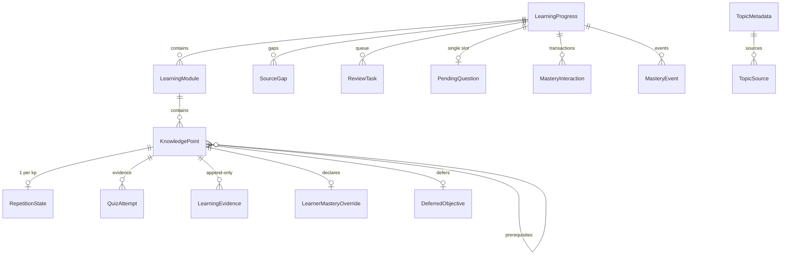

# 01 · 数据模型与不变量

> 依据 ADR-002/003/006/007/008/009/010。字段为规范定义；实现用 Pydantic v2（`extra="ignore"` 兼容历史数据）。
> 目标始终保留：见 `TopicMetadata.goal` 与 `INV-13`。调度相关字段的语义见 `04-scheduling.md`。

## 一、枚举

- **KnowledgeType**：`memory` | `concept` | `procedure` | `design`。未知字符串拒绝；历史中文值读取时映射。见 `INV-16`、`INV-26`。
- **InteractionStatus**：`registered` | `awaiting_input` | `answered` | `graded` | `abandoned`
- **AssessmentType**：`quiz` | `qualitative` | `review`
- **AssessmentResult**：`correct` | `incorrect` | `partial`
- **ObjectiveStatus**（派生）：`new` | `learning` | `mastered`
- **KnowledgeOrigin / Provenance**（派生）：`system` | `learner` | `""`
- **Grounding**（派生/标记）：`grounded` | `ungrounded`
- **GapKind**：`goal_gap` | `source_omission`

## 二、实体

### KnowledgePoint
| 字段 | 类型 | 必填 | 说明 |
| --- | --- | --- | --- |
| `id` | str | ✔ | 稳定 ID，创建后不变 |
| `name` | str | ✔ | ≥2 字符 |
| `type` | KnowledgeType | ✔ | **创建后只读**（ADR-003 / `INV-06`） |
| `module_id` | str | ✔ | 所属模块 |
| `prerequisite_ids` | list[str] | | 先修目标；**硬门控**（ADR-010 / `INV-27`） |
| `source_ids` | list[str] | | 依据来源；为空 ⇒ `ungrounded` |
| `grounding` | `grounded`\|`ungrounded` | | 派生：`source_ids` 是否非空 |
| `required_evidence` | list[str] | | 附加必需证据类型（类比 `required_visual_tasks`，`INV-28`） |

### LearningModule
| 字段 | 类型 | 必填 | 说明 |
| --- | --- | --- | --- |
| `id` / `name` / `order` | | ✔ | |
| `objective` | str | | 一句话能力契约；`mastery_revise` 的语义边界（提示级） |
| `display_target` | float | | 默认 `0.7`，**仅展示，不参与推进**（原 `pass_threshold`，见 `INV-18`） |
| `knowledge_points` | list[KnowledgePoint] | | |

### LearningProgress（path 聚合根）
| 字段 | 类型 | 说明 |
| --- | --- | --- |
| `path_id` / `name` / `goal` | str | `goal` **始终保留**（`INV-13`） |
| `modules` | list[LearningModule] | |
| `current_module_id` / `current_kp_index` | | 展示用 |
| `knowledge_types` | dict[kp,KnowledgeType] | |
| `mastery_levels` | dict[kp,float] | **系统分数** |
| `qualitative_mastery` | dict[kp,bool] | 概念/设计定性通过 |
| `quiz_attempts` | list[QuizAttempt] | 量化证据 |
| `learning_evidence` | list[LearningEvidence] | 复习/评估证据，**只追加** |
| `repetition_states` | dict[kp,RepetitionState] | 每 KP 一份 |
| `review_queue` | list[ReviewTask] | 由调度器生成 |
| `learner_mastery_overrides` | dict[kp,LearnerMasteryOverride] | 声明掌握 |
| `deferred_objectives` | dict[kp,DeferredObjective] | |
| `explained_objectives` | dict[kp,dict] | |
| `source_gaps` | list[SourceGap] | 缺口记录（`INV-23`） |
| `proposals` | list[ObjectiveProposal] | 学习中提议的候选 KP（`INV-53/54`） |
| `coverage` | CoverageReport\|None | 最近一次 build 的覆盖报告（`INV-56`） |
| `pending_question` | PendingQuestion\|None | **单槽位**（`INV-02`） |
| `desired_retention` | float | 默认 `0.9`，区间 `[0.7,0.99]` |
| `version` | int | CAS 版本 |
| `created_at` / `updated_at` | float | |

> **二期字段（MVP 不做，登记以免破坏性变更）**：`scenario`（预设场景）。见 `04-scheduling.md`。

### PendingQuestion（服务端，答案不外泄）
`question_id` · `knowledge_point_id` · `module_id` · `prompt` · `question_type`(`choice|short|open`) · `expected_answer`（服务端）· `options`([{label,body}]) · `explanation`（服务端）· `difficulty` · `accepted_answers` · `created_at`。
公共投影 **不得**含 `expected_answer`/`explanation`（`INV-07`）。

### QuizAttempt
`question_id` · `knowledge_point_id` · `module_id` · `is_correct` · `user_answer` · `error_type` · `independent` · `mastery_estimate` · `voided` · `void_reason` · `timestamp`

### LearningEvidence（只追加）
`evidence_id` · `question_id` · `knowledge_point_id` · `assessment_type` · `result` · `quality` · `hints_used` · `attempt_count` · `session_id` · `turn_id` · `source` · `timestamp`

### RepetitionState
| 字段 | 类型 | 说明 |
| --- | --- | --- |
| `kp_id`（key） | str | |
| `interval_index` / `consecutive_correct` / `consecutive_wrong` | int | SM-2 间隔序列（`INV-31`） |
| `next_review_at` / `last_review_at` / `last_scheduled_at` | float\|None | 锚点三件套（`INV-29/30`） |
| `scheduled_after_failure` | bool | "锚点由失败设置"标记（`INV-30`） |
| `lapse_count` / `review_count` | int | |
| `provenance` | `system`\|`learner` | 播种依据（ADR-002） |
| `desired_retention` | float | 从 path 拷贝 |
| `ease_factor` | float | SM-2 EF，默认 2.5，下限 1.3 |
| `difficulty` / `stability` / `retrievability` | float | **FSRS 字段，SM-2 下仅展示或删除**（`INV-31`） |

### ReviewTask
`id` · `knowledge_point_id` · `knowledge_type` · `due_at` · `priority` · `forgetting_risk` · `reason` · `state`(RepetitionState) · `evidence_source` · `evidence_id`

### MasteryInteraction（题目事务，幂等）
`interaction_id` · `path_id` · `question`(PendingQuestion) · `status` · `session_id` · `turn_id` · `user_answer` · `result` · `created_at` · `updated_at`。**终态保留**（`INV-22`）。

### MasteryEvent（领域事件，只追加）
`id`(自增) · `path_id` · `revision` · `event_type` · `payload` · `session_id` · `turn_id` · `created_at`

### LearnerMasteryOverride / DeferredObjective
`knowledge_point_id` · `note` · `created_at`

### SourceGap（缺口记录）
| 字段 | 类型 | 说明 |
| --- | --- | --- |
| `id` | str | |
| `kind` | `goal_gap`\|`source_omission` | 缺口方向 |
| `ref` | str | kp_id 或 source_id |
| `reason` | str | |
| `candidate_source_ids` | list[str] | 可能补上的来源 |
| `resolution` | `""`\|`accepted`\|`regenerated` | 处理结果 |
| `created_at` | float | |

### ObjectiveProposal（学习中提议的候选 KP · ADR-017）
| 字段 | 类型 | 说明 |
| --- | --- | --- |
| `id` | str | |
| `path_id` | str | |
| `name` | str | 候选目标名（≥2 字） |
| `type` | KnowledgeType | 候选类型 |
| `reason` | str | 为什么需要它（学习中发现） |
| `source_ids` | list[str] | 支撑来源（可空 ⇒ 未接地） |
| `module_id` | str | 拟归属模块（可空） |
| `status` | `pending`\|`accepted`\|`rejected` | 仅在 outline reconcile 时流转 |
| `proposed_by` | `learner`\|`tutor` | |
| `session_id` / `turn_id` | str | 审计 |
| `created_at` | float | |

> 候选**不是 KP**：不影响 `map`/`next_objective`/门槛，直到 outline 时 accept（走 `mastery_revise` 成为 KP）。

### CoverageReport（生成质量覆盖报告 · ADR-018）
| 字段 | 类型 | 说明 |
| --- | --- | --- |
| `documents` | int | 选中来源总数 |
| `covered` | int | 被至少一个模块/KP 用上的来源数 |
| `missing` | list[{label, document}] | 未被覆盖的来源 |
| `reported` | bool | 模型是否声明了 materials；`false` ⇒ 不作结论 |
| `grounding_ratio` | float | 有可解析来源的 KP / 总 KP |
| `acyclic` | bool | 前置图无环 |

### TopicMetadata / TopicSource
- `TopicMetadata`：`path_id` · `goal` · `description` · `emoji` · `status`(active\|archived) · `created_at` · `updated_at`
- `TopicSource`：`id` · `kind`(`goal|book|notebook|knowledge_base|file`) · `source_id` · `label` · `excerpt` · `position` · `available`

## 三、关系图



## 四、状态派生（纯函数）

```
objective_status(kp):
    is_mastered(kp) ? "mastered"
    : (有 attempt 或 kp ∈ qualitative_mastery) ? "learning" : "new"

mastery_source(kp):
    is_assessed_mastered(kp) ? "system"
    : kp ∈ learner_mastery_overrides ? "learner" : ""

is_mastered(kp) = is_assessed_mastered(kp) or kp ∈ learner_mastery_overrides

is_assessed_mastered(kp):
    required_evidence ⊆ 已达成证据(kp)  AND
    ( type ∈ {concept,design} ? qualitative_mastery.get(kp,False)
                              : mastery_levels.get(kp,0.0) >= 0.9 )

eligible(kp) = 所有 prerequisite_ids 均 is_mastered     # INV-27

next_objective(progress):
    eligible 且未掌握且未 deferred 的 KP，按 (module.order, kp 顺序) 取第一个
    全掌握/已 defer 时：有待答题→"answer_pending"；有到期→"review"；否则→"complete"
```

## 五、不变量清单（INV-01…60）

> 每条至少被一个测试覆盖（追踪表见各文档）。

### 基础（M1）
| ID | 不变量 |
| --- | --- |
| INV-01 | **声明不写分**：有 override 时，不得写改 `mastery_levels[kp]` |
| INV-02 | **单槽位**：同 path 至多 1 个非终态 interaction |
| INV-03 | **门槛推进**：`is_mastered = assessed OR override`；`next_objective` 跳过已掌握 |
| INV-04 | **量化门槛**：memory/procedure ⟺ `mastery_levels ≥ 0.9` |
| INV-05 | **定性门槛**：concept/design ⟺ `qualitative_mastery=True`；量化分不参与 |
| INV-06 | **类型只读**：已存在 KP 的 `type` 不可变 |
| INV-07 | **答案不外泄**：`expected_answer`/`explanation` 不入学习者可见投影 |
| INV-08 | **调用期门控**：错误模式下调用被拒且零状态变更 |
| INV-09 | **未记录模式不门控**：mode 缺失时全部放行 |
| INV-10 | **复习禁考未掌握**：review 下对未掌握 KP 的 quiz/grade/assess 被拒 |
| INV-11 | **CAS 写**：经 `mutate()` 以 `version` 校验，冲突不静默覆盖 |
| INV-12 | **证据只追加** |
| INV-13 | **目标保留**：`goal` 非显式编辑不得清空 |
| INV-14 | **作废不计**：`voided=True` 的 attempt 不计任何账 |
| INV-15 | **声明不产证据**：override 不产生 `learning_evidence` |
| INV-16 | **类型解析**：未知拒绝；历史中文值读取映射 |
| INV-17 | **缺省安全**：分类未声明不得默认共享（fail-closed） |
| INV-18 | **模块阈值不推进**：`display_target` 不参与推进，推进仅由 `is_mastered(kp)` 决定 |
| INV-19 | **调度内部量隐藏**：学习者不可直接读写 `S₀/D₀/更新公式` |
| INV-20 | **场景不追溯**：场景变更默认只影响新条目（二期字段） |
| INV-21 | **判分幂等键** = `(path_id, interaction_id)`；session/turn 不参与 |
| INV-22 | **终态可查**：graded/abandoned 事务保留；重复 grade 返回首次结果且不新增证据 |
| INV-23 | **缺口显式**：必须生成 `SourceGap` 交用户选择；禁止静默重建/静默丢弃 |
| INV-24 | **未接地可见**：接受缺口后 KP 标记 `ungrounded` 且可查询；补来源后自动消解 |
| INV-25 | **未接地的掌握/出题策略**（产品选择，见 §六） |
| INV-26 | **类型单值**：生成器产出跨类型目标必须拆分为多 KP |
| INV-27 | **前置硬门控**：前置未掌握 → 不进入 `next_objective` 且不可被评估 |
| INV-28 | **附加证据**：用 `required_evidence` 表达，不改类型 |
| INV-29 | **锚点规则**：失败/成功只改 `next_review_at`+`last_scheduled_at`；会话内练习只改 `last_review_at` |
| INV-30 | **锚点来源**：`scheduled_after_failure=True ⇔ 当前锚点由失败设置` |
| INV-31 | **算法不混用**：SM-2 或 FSRS 二选一显式声明 |
| INV-32 | **判分不调 LLM**：参照物全部注册时固定 |
| INV-33 | **choice 解析失败不判错**：返回未判分 |
| INV-34 | **short 归一化固定**；模糊阈值 `0.90`；>30 字回退精确 |
| INV-35 | **open 关键词注册时固定**；阈值同 §06；open 不单独授予掌握 |
| INV-36 | **提示降级**：`hints_used>0` → `partial` |
| INV-37 | **事件只在成功提交时发出** |
| INV-38 | **事件单调**：`id`/`revision` 单调；`events?since` 返回其后全部 |
| INV-39 | **mode.changed 为 session 级**，不入 path 聚合 |
| INV-40 | **build 入参校验**：name≥2 / type∈enum / 名唯一 / 前置可解析 |
| INV-41 | **非空路径 build = 重建须 confirm** |
| INV-42 | **revise 以 id 差分保进度**；已存在 KP 的 `type` 不可改 |
| INV-43 | **共用 schema**：build/revise 与 `PUT map` 同一 `Module/KP` |
| INV-44 | **quiz 结束回合**：其后工具不执行 |
| INV-45 | **grade 幂等**：重复调用返回首次结果且不新增证据 |
| INV-46 | **ungraded 零状态变更**，不记负证据 |
| INV-47 | **成功切换记 `mode.changed`（含 actor）**，session 级 |
| INV-48 | **被拒切换默认不持久** |
| INV-49 | **`mode.changed` 与时间线按 `turn_id` 对齐** |
| INV-50 | **逻辑并发由 CAS 保证**，跨线程/进程一致；物理串行仅为性能 |
| INV-51 | **状态与事件同事务**提交或同滚 |
| INV-52 | **workspace 隔离 = 独立 DB 文件**，跨 workspace 无共享锁 |
| INV-53 | **捕获不改结构**：study/review 下只可新增 `ObjectiveProposal`/`SourceGap`/备注，**不得**增删改模块/KP（结构改动仅 outline） |
| INV-54 | **候选非 KP**：proposal 不影响 `map`/`next_objective`/门槛；仅 outline accept 时经 `mastery_revise` 成为 KP |
| INV-55 | **地图为可版本化草案**：build/revise 递增 `version`；近似性由 `CoverageReport` 暴露，不假装完备 |
| INV-56 | **build 必须返回覆盖报告**（covered/total/missing/reported） |
| INV-57 | **质量以确定性指标为准**：coverage/grounding/acyclic/count-in-bounds；语义指标用嵌入匹配（`09`） |
| INV-58 | **来源纪律**：不得为未接地（`ungrounded`）KP 声称来源支撑 |
| INV-59 | **行为越界由引擎拒绝**：意图白/黑名单与前置校验在调用期生效（不靠提示词） |
| INV-60 | **行为预算**：单回合工具调用、连续追问、同题提示均设上限，超限拒绝（`08`） |

## 六、INV-25 已确认

- **INV-25（已确认，方案 A）**：未接地（`ungrounded`）KP **可以**被掌握，但证据标记为"未接地"，且题库条目**不带来源链接**；补来源后自动消解。
